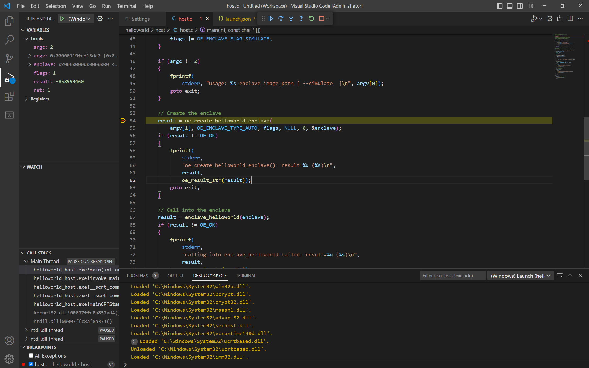
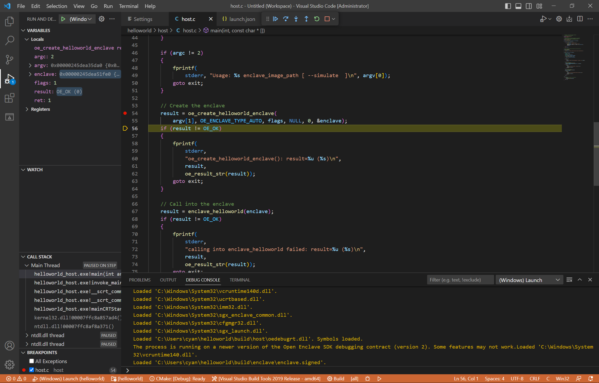
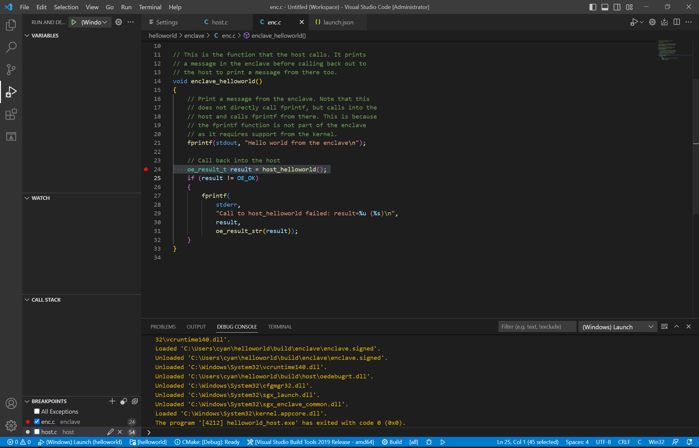

# Building And Debugging Using Visual Studio Code on Windows

This document provides a brief overview of how to build and debug Open Enclave applications using VS Code on Windows.

## Install VS Code

The latest version of Visual Studio Code can be installed from [https://code.visualstudio.com/](https://code.visualstudio.com/)

## Install VS Code Extensions

Install the following VS Code extensions. Click on an image to navigate to the Visual Studio Code Marketplace page for the extension.

[](https://marketplace.visualstudio.com/items?itemName=ms-vscode.cpptools)

[](https://marketplace.visualstudio.com/items?itemName=vector-of-bool.cmake-tools)


## Launch Visual Studio Code and Configure

Launch Visual Studio Code from the Windows Start menu.

In the Command Palette, type "CMake: Select a Kit" and select the "Visual Studio Build Tools 2019 - amd64".

Note that this example uses the tools you get when you download and install the [Visual Studio Build Tools 2019](https://aka.ms/vs/16/release/vs_buildtools.exe) and choose the "C++ build tools" workload. Visual Studio Build Tools 2019 has support for CMake Version 3.15 (CMake ver 3.12 or above is required for building Open Enclave SDK).


Open Workspace Settings by pressing Ctrl+Shift+P and typing "Open Workspace Settings" in the command palette.


Search for the setting "CMake Path" and change the path to point to the CMake executable you would like to use.

In this example we are using the CMake executable that comes when you install Visual Studio build tools 2019 and choose the C++ build tools workload(with the C++ CMake Tools for Windows).


After this is done, Settings.json created in the .vscode folder would contain the following:

```json
{
    "cmake.cmakePath": "C:\\Program Files (x86)\\Microsoft Visual Studio\\2019\\BuildTools\\Common7\\IDE\\CommonExtensions\\Microsoft\\CMake\\CMake\\bin\\cmake.exe"
}
```

## Configure Your Workspace

Open Workspace Settings by pressing Ctrl+Shift+P and typing "Open Workspace Settings" in the command palette.


Search for the setting "CMake Configure Args" and add an item `-DNUGET_PACKAGE_PATH=path-to-openenclave-nuget-packages`.
Add another item `-DCMAKE_PREFIX_PATH=YourOpenEnclaveInstallFolder\lib\openenclave\cmake`


For example, if you ran install-windows-prereqs.ps1 with -InstallPath C:\openenclave_prereqs, and you installed the OE SDK nuget package to C:\openenclave, Settings.json would be as below:

```json
{
    "cmake.cmakePath": "C:\\Program Files (x86)\\Microsoft Visual Studio\\2019\\BuildTools\\Common7\\IDE\\CommonExtensions\\Microsoft\\CMake\\CMake\\bin\\cmake.exe",
    "cmake.configureArgs": [
        "-DNUGET_PACKAGE_PATH=C:\\openenclave_prereqs",
        "-DCMAKE_PREFIX_PATH=C:\\openenclave\\lib\\openenclave\\cmake"
    ]
}
```

You will need to use Ninja generator to build OE SDK. This can be set by finding the setting "CMake: Generator" and setting it to `Ninja`.

Configure your workspace by typing "cmake configure" in the command palette


Configuration should successfully complete.


## Build And Run Your Open Enclave Application

Build the application by pressing F7 or typing "CMake Build a target" in the command palette, and selecting the "all META" target.


Run your application by pressing Shift+F7 or typing "CMake Build a target" in the command palette, and selecting the "run UTILITY" target.


## Configuring Intellisense

Intellisense should work out of the box for files within your workspace. However, Intellisense may not be aware of where to locate the Open Enclave SDK headers.
Open settings.json under the .vscode folder and add entries for "C_Cpp.default.includePath" and "C_Cpp.default.systemIncludePath".
If you installed the Open Enclave SDK at `C:\openenclave`, the Settings.json would be as below:

```json
{
    "cmake.cmakePath": "C:\\Program Files (x86)\\Microsoft Visual Studio\\2019\\BuildTools\\Common7\\IDE\\CommonExtensions\\Microsoft\\CMake\\CMake\\bin\\cmake.exe",
    "cmake.configureArgs": [
        "-DNUGET_PACKAGE_PATH=C:\\openenclave_prereqs",
        "-DCMAKE_PREFIX_PATH=C:\\openenclave\\lib\\openenclave\\cmake"
    ],
    "C_Cpp.default.includePath": ["C:\\openenclave\\include"],
    "C_Cpp.default.systemIncludePath": [
        "C:\\openenclave\\include\\openenclave\\3rdparty\\libc",
        "C:\\openenclave\\include\\openenclave\\3rdparty\\libcxx"
    ]
}
```

## Debug Your Open Enclave Application

Open the file you want to debug. For example, `host\host.c`. 

In the side panel, open "Run and Debug" and select "Create a launch.json file". In the selector for choosing a debugger, choose "C++ (Windows)" which you should then see a new launch.json file. You can either copy the below configuration, or create your own by selecting "Add Configuration" and then "C/C++: Windows (Launch)".

```json
{
    "version": "0.2.0",
    "configurations": [
        {
            "name": "(Windows) Launch",
            "type": "cppvsdbg",
            "request": "launch",
            "program": "${workspaceRoot}/build/host/helloworld_host.exe",
            "args": ["enclave/enclave.signed"],
            "stopAtEntry": false,
            "cwd": "${workspaceRoot}/build",
            "environment": [],
            "console": "externalTerminal"
        }
    ]
}
```

Add a breakpoint, and then start debugging (For example pressing the run button, or F5).



Step over the line that creates the enclave. The Console pane should show that the enclave has been loaded.



Open enc.c and put a breakpoint and continue execution (this doesn't work - doesn't stop at breakpoint!)



## Additional information

For known limitations and further details about Windows C/C++ debugging on Visual Studio Code, see [Debug C++ in Visual Studio Code](https://code.visualstudio.com/docs/cpp/cpp-debug)
